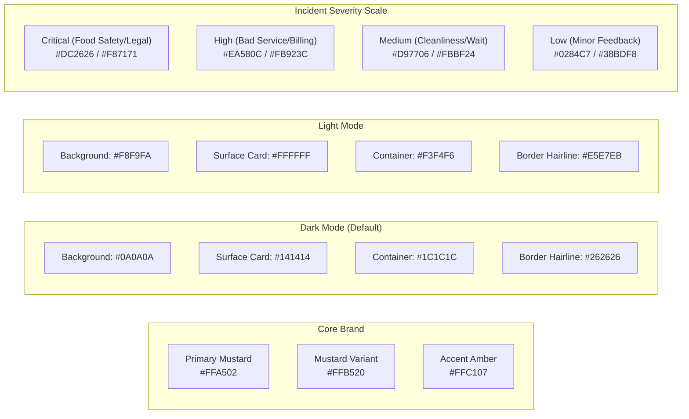
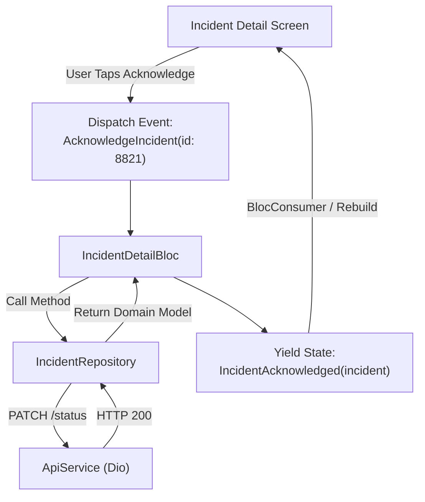
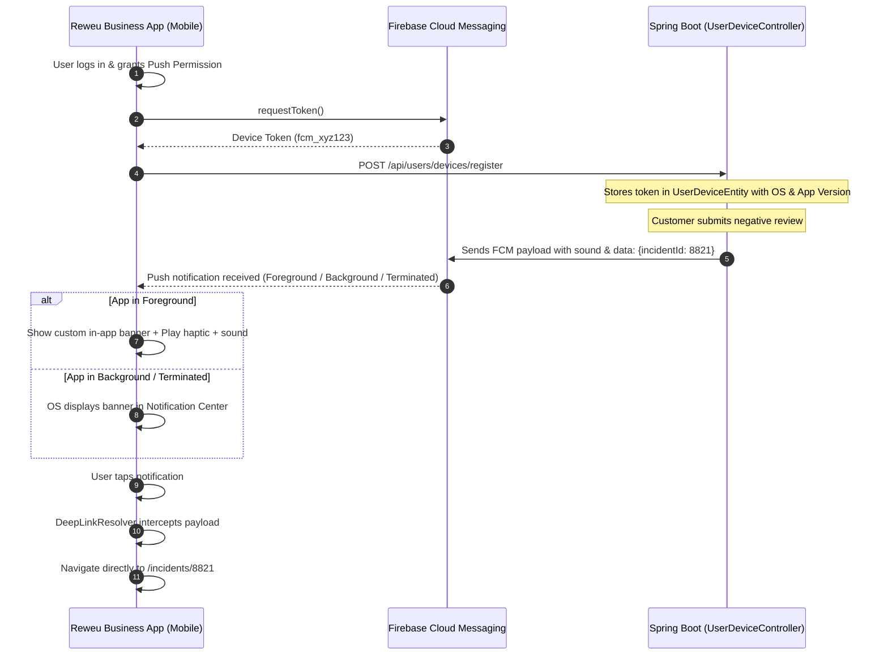

# Reweu Business Mobile App: Architecture, Design System & Engineering Guidelines

> **Target Platform:** iOS & Android (Flutter)  
> **Target Audience:** Business Owners, Franchisees, Regional Directors & Branch Managers  
> **Core Mission:** Ultra-low-latency Incident Triage, Customer Recovery, and Real-Time Operational Monitoring on mobile devices.

---

## 1. Architectural Blueprint & Project Structure

### 1.1 Architecture Pattern: Clean Feature-First Architecture with BLoC
The app utilizes a **Clean Feature-First Architecture** powered by `flutter_bloc`. This cleanly decouples presentation from business logic and data sources, facilitating >80% code reuse from the existing `reweuadminpanel` while adhering to robust mobile engineering standards.

```
reweu_business/
├── android/
├── ios/
├── assets/
│   ├── fonts/                  # Bundled offline fonts (Outfit, Plus Jakarta Sans)
│   ├── icons/                  # SVG and PNG icons (branded & status glyphs)
│   ├── sounds/                 # Custom alert sounds (e.g., critical_incident.mp3 / .caf)
│   └── languages/              # i18n JSON files (en-US.json, ur-PK.json)
├── lib/
│   ├── main.dart               # Entry point, Firebase & DI initialization
│   ├── app.dart                # App widget, BlocProviders, Theme, Routing
│   ├── core/                   # Shared cross-cutting concerns
│   │   ├── config/             # Environment configs (API Base URL, Sentry, FCM channels)
│   │   ├── constants/          # App constants, storage keys, route paths
│   │   ├── errors/             # Failure models, AppException definitions
│   │   ├── network/            # Dio client, Auth/Logging/Retry interceptors
│   │   ├── storage/            # SecureStorageManager, SharedPrefsManager
│   │   ├── biometrics/         # LocalAuthService (Face ID, Touch ID, Fingerprint)
│   │   ├── push/               # FCMNotificationService, LocalNotificationManager, DeepLinkResolver
│   │   └── utils/              # Haptics, Formatters, Date helpers, ContentDirection
│   ├── theme/                  # Design System & UI Foundation
│   │   ├── app_palette.dart    # Semantic color palette (Light & Dark modes)
│   │   ├── app_typography.dart # Outfit & Plus Jakarta Sans type definitions
│   │   ├── app_spacing.dart    # 8-pt grid constants & radii
│   │   ├── app_theme.dart      # ThemeData factories (Light & Dark)
│   │   └── app_motion.dart     # Duration & Curve tokens, micro-interactions
│   ├── data/                   # Global Data Layer & Reusable DTOs
│   │   ├── models/             # Incident, Review, User, Branch, Voucher models (json_serializable)
│   │   ├── services/           # ApiService, UserService, StorageService
│   │   └── repositories/       # AuthRepository, IncidentRepository, DeviceRepository
│   ├── features/               # Feature Modules (Feature-First)
│   │   ├── auth/               # Login, Biometric Unlock, Multi-Branch Selector
│   │   │   ├── bloc/
│   │   │   ├── screens/
│   │   │   └── widgets/
│   │   ├── incidents/          # Feed, Filters, Incident Detail, Internal Notes, Triage
│   │   │   ├── bloc/           # IncidentFeedBloc, IncidentDetailBloc, IncidentActionCubit
│   │   │   ├── screens/        # IncidentFeedScreen, IncidentDetailScreen
│   │   │   └── widgets/        # IncidentCard, SeverityPill, TimelineStream, ActionSheet
│   │   ├── recovery/           # Service Recovery & Customer Voucher Sheet
│   │   │   ├── cubit/
│   │   │   └── widgets/        # VoucherRecoveryModal, CustomerContactBar
│   │   ├── analytics/          # Quick KPIs, MTTR, Repeat Issues
│   │   │   ├── bloc/
│   │   │   ├── screens/
│   │   │   └── widgets/        # KpiMetricCard, SeverityBreakdownChart
│   │   └── settings/           # Push notification toggles, sound selection, branch profile
│   └── routes/                 # AppRouter (go_router or Navigator with DeepLink handling)
└── test/                       # Unit & Widget tests
```

---

## 2. Design System: Theme, Palette & Visual Hierarchy

The Reweu Business App must exude an **executive, high-urgency, and professional operational tone**. It retains Reweu’s signature warm mustard branding while providing an OLED-optimized Dark Mode (default for night-shift operators) and a clean, high-contrast Light Mode.

### 2.1 Color Palette & Contrast Compliance (WCAG AA/AAA)



| Token Name | Light Value | Dark Value | Purpose & Accessibility Rule |
| :--- | :--- | :--- | :--- |
| `primaryBrand` | `#FFA502` | `#FFA502` | Reweu brand mustard. Text placed ON brand must be `#0A0A0A` (11.8:1 AAA). |
| `brandText` | `#9A5C00` (5.1:1 on white) | `#FFB520` (luminous) | Contrast-compliant mustard for text/icons on card surfaces. |
| `background` | `#F8F9FA` | `#0A0A0A` | Screen base background. Pure obsidian in dark mode to save OLED power. |
| `surface` | `#FFFFFF` | `#141414` | Primary card background with 1px border. |
| `surfaceContainer` | `#F3F4F6` | `#1C1C1C` | Text fields, filter chips, metric containers. |
| `border` | `#E5E7EB` | `#262626` | 1.0 physical pixel border on cards and separators. |
| `severityCritical` | `#DC2626` (Red 600) | `#F87171` (Coral 400) | 1-Star reviews, hygiene violations, food poison warnings. |
| `severityHigh` | `#EA580C` (Orange 600)| `#FB923C` (Amber 400) | Staff behavior, incorrect billing, extreme delays. |
| `severityMedium` | `#D97706` (Amber 600) | `#FBBF24` (Amber 400) | Ambience complaints, noise, minor food temperature. |
| `severityLow` | `#0284C7` (Sky 600) | `#38BDF8` (Sky 400) | General suggestions, neutral feedback. |

### 2.2 Elevation, Depth & Tactile Finish
- **Borders over Shadows in Dark Mode**: Dark mode cards avoid muddy drop-shadows; instead, use subtle hairline borders (`Border.all(color: context.palette.border, width: 1.0)`) and distinct surface stepped elevations (`#0A0A0A` $\rightarrow$ `#141414` $\rightarrow$ `#1C1C1C`).
- **Tactile Materials & Liquid Glass**: For floating sticky bottom action bars and sticky filter headers, apply BackdropFilter (`ImageFilter.blur(sigmaX: 12, sigmaY: 12)`) with 85% opacity surface overlay to preserve ambient context while scrolling.

---

## 3. Typography System & Font Strategy

### 3.1 Dual-Font Pairing: Outfit + Plus Jakarta Sans
In alignment with modern executive dashboards and the Reweu Admin Panel:
1. **Headings & Quantitative Data (`Outfit`)**: Geometric, modern numbers and high-impact headers. Used for incident codes (e.g. `INC-261017-0482`), star ratings (`1.0 ★`), SLA timers (`14m ago`), and MTTR stats.
2. **Body, Notes & Customer Reviews (`Plus Jakarta Sans`)**: Clean humanist grotesque with high x-height and open apertures, optimized for rapid scanning of customer review texts on mobile screens.

```dart
class AppTypography {
  static const String headingFont = 'Outfit';
  static const String bodyFont = 'PlusJakartaSans';

  // Headlines (Outfit)
  static TextStyle h1 = TextStyle(fontFamily: headingFont, fontSize: 28, fontWeight: FontWeight.bold, height: 1.2);
  static TextStyle h2 = TextStyle(fontFamily: headingFont, fontSize: 22, fontWeight: FontWeight.bold, height: 1.25);
  static TextStyle h3 = TextStyle(fontFamily: headingFont, fontSize: 18, fontWeight: FontWeight.w600, height: 1.3);
  static TextStyle metric = TextStyle(fontFamily: headingFont, fontSize: 32, fontWeight: FontWeight.w700, letterSpacing: -0.5);

  // Body & Operations (Plus Jakarta Sans)
  static TextStyle bodyLarge = TextStyle(fontFamily: bodyFont, fontSize: 15, fontWeight: FontWeight.w400, height: 1.5);
  static TextStyle bodyMedium = TextStyle(fontFamily: bodyFont, fontSize: 14, fontWeight: FontWeight.w500, height: 1.45);
  static TextStyle bodySmall = TextStyle(fontFamily: bodyFont, fontSize: 12, fontWeight: FontWeight.w500, height: 1.4);
  static TextStyle caption = TextStyle(fontFamily: bodyFont, fontSize: 11, fontWeight: FontWeight.w600, letterSpacing: 0.5);
  static TextStyle button = TextStyle(fontFamily: bodyFont, fontSize: 14, fontWeight: FontWeight.w600, letterSpacing: 0.2);
}
```

### 3.2 Offline Font Bundling Rule
- **Zero Network Font Fetching**: To prevent latency, layout shifts, or blank-text rendering during network drops, all font assets (`.ttf`) must be bundled directly in `assets/fonts/` and declared in `pubspec.yaml`.
- **RTL & Urdu Typography**: When displaying customer reviews written in Urdu, automatically assign `Noto Nastaliq Urdu` using content-detection (`contentDirection(text)`) to prevent broken rendering or clipped descenders.

---

## 4. State Management & Architectural Patterns

### 4.1 BLoC Pattern (Business Logic Component)
Every interactive feature follows the strict **BLoC** event-driven pattern (`flutter_bloc`):



### 4.2 Layer Responsibilities & Contracts

#### Data Layer
- **DTOs & Models**: Stored in `data/models/`. Uses `json_serializable` with explicit null-safety.
  - `IncidentListResponse`: High-level feed summary.
  - `IncidentDetailResponse`: Full customer review, timestamps, rating dimensions, and activity history.
  - `AssigneeInfo`: Staff member handling the incident.
- **Remote Services**: `ApiService` wraps Dio with:
  1. `AuthInterceptor`: Attaches `Authorization: Bearer <token>` from `SecureStorageManager`.
  2. `ErrorInterceptor`: Maps Dio 401/403/500 into custom `AppException` types (`UnauthorizedException`, `ServerException`, `NetworkException`).
  3. `SessionExpiredHandler`: Triggers global logout stream when a 401 occurs.

#### Domain / Repository Layer
- `IncidentRepository` provides clean asynchronous interfaces:
  - `Future<PaginatedResponse<IncidentListResponse>> getIncidents({required int businessId, int? branchId, String? status, int page, int size})`
  - `Future<IncidentDetailResponse> getIncidentDetail(int incidentId)`
  - `Future<IncidentDetailResponse> addComment(int incidentId, String comment)`
  - `Future<void> updateStatus(int incidentId, {required String status, String? summary, bool sendVoucher, double? voucherAmount})`
  - `Future<IncidentAnalyticsResponse> getAnalytics(int businessId, {DateTime? startDate, DateTime? endDate})`

#### Presentation Layer
- **Smart Screens vs Dumb Widgets**: Screens inject and consume Blocs (`BlocProvider`, `BlocConsumer`). Child widgets (like `IncidentCard`, `SeverityPill`, `MetricItem`) are pure presentation widgets taking immutable data and callback actions.

---

## 5. Push Notifications, Deep Linking & Device Lifecycle

### 5.1 Push Notification Architecture (FCM & APNs)



### 5.2 Device Registration Contract (Verified Backend Implementation)
We discovered that `reweuBackend` **already implements** `UserDeviceController.kt`! The mobile app must connect directly to this endpoint:

- **Endpoint**: `POST /api/users/devices/register`
- **Headers**: `Authorization: Bearer <JWT_TOKEN>`
- **Payload Schema**:
```json
{
  "deviceToken": "fcm_token_string_here",
  "deviceName": "iPhone 16 Pro",
  "deviceType": "mobile",
  "osType": "ios",
  "osVersion": "18.1",
  "appVersion": "1.0.0"
}
```
- **Unregister on Logout**: `DELETE /api/users/devices/unregister?deviceToken=<TOKEN>`

### 5.3 Notification Channels & Sound Customization
- **Android Notification Channels**:
  - `critical_incidents_channel`: Importance `MAX`, sound `critical_alert.mp3`, vibration pattern `[0, 500, 200, 500]`, bypass DND where permitted.
  - `general_alerts_channel`: Importance `DEFAULT`, standard chime.
- **iOS APNs Category**:
  - Category `INCIDENT_ALERT` with custom sound `critical_alert.caf`.
  - Action buttons in banner: `[ "Acknowledge", "View Incident" ]`.

---

## 6. Mobile UX, Interaction Rules & HIG Compliance

### 6.1 Touch Targets & Finger Ergonomics
- **Minimum Tap Target**: Every interactive button, filter chip, or icon button must provide at least **44 × 44 pt** tap bounds, even if the visible glyph is 20 × 20 pt.
- **Bottom-Weighted Navigation & Triage**: Since users operate smartphones one-handed during restaurant service:
  - Critical incident actions ("Acknowledge", "Resolve", "Send Voucher", "Call Customer") are docked in a sticky bottom sheet or bottom action bar.
  - Primary filter controls sit within natural thumb reach.

### 6.2 Haptic Feedback Matrix
Tactile confirmation reassures managers under stress that an urgent command succeeded:
- **Light Impact (`HapticFeedback.lightImpact()`)**: Pull-to-refresh trigger, tab switching, filter selection.
- **Medium Impact (`HapticFeedback.mediumImpact()`)**: Internal comment posted, swipe-to-acknowledge gesture completed.
- **Heavy / Success Notification (`HapticFeedback.heavyImpact()` / `notificationSuccess`)**: Incident resolved, service recovery voucher successfully issued to customer.
- **Error Notification (`HapticFeedback.vibrate()`)**: Network failure or failed status transition.

### 6.3 Offline Resilience & Optimistic UI
- **Incident Feed Cache**: Cache the last 50 incidents in local memory or encrypted SQLite/Hive so opening the app during network blips displays immediate data without a blank white screen.
- **Skeletonizer Loading States**: When fetching fresh feed data, avoid jarring spinners. Use `skeletonizer` containers matching the exact layout of `IncidentCard`.

---

## 7. Rules and Regulations (Engineering Standards)

### Rule 1: Zero Hardcoded Colors or Styles
Never use raw `Color(0xFF...)` or `TextStyle(...)` literals inside widgets. Always reference the theme context:
- Correct: `color: context.palette.surface` or `AppTheme.getSurfaceColor(context)`
- Correct: `style: context.typography.bodyMedium`

### Rule 2: Strictly Typed Immutability
- All Bloc events, states, and data models must be immutable (`@immutable`) with `final` fields and `const` constructors where applicable.
- Model serialization must use `json_serializable` and `build_runner`. Never parse untyped `Map<String, dynamic>` ad-hoc inside UI widgets.

### Rule 3: Error Handling & User-Facing Recovery
- Every API call must be caught and converted to a typed failure.
- Never display raw stack traces or `Exception: DioException [bad response]` to business owners. Display clean, actionable error messages with a "Retry" button.

### Rule 4: Directional Layouts (RTL Readiness)
- Always use directional layout properties:
  - `EdgeInsetsDirectional.fromSTEB(...)` instead of `EdgeInsets.fromLTRB(...)`
  - `AlignmentDirectional.centerStart` instead of `Alignment.centerLeft`
  - `PositionedDirectional` instead of `Positioned`
- Wrap customer feedback text with `Directionality(textDirection: contentDirection(review.comment), child: ...)` to ensure Arabic/Urdu reviews render correctly.

### Rule 5: Credential & Token Security
- Sensitive tokens (JWT, Refresh Token, User ID, Biometric Keys) must **only** reside in `flutter_secure_storage`.
- Never log full JWT tokens or authorization headers in production logs (`run_command` or Flutter console).

---

## 8. Critical Backend Discoveries & Action Items

During codebase inspection of `c:\Spring Boot\reweuBackend`, we uncovered two key insights:

> [!IMPORTANT]
> **Discovery 1: Device Token Controller is already live!**  
> `UserDeviceController.kt` exists with `POST /api/users/devices/register` and accepts `DeviceRegistrationRequest`. The mobile app can integrate device registration immediately.

> [!WARNING]
> **Discovery 2: Push Dispatch Bypass in `IncidentServiceImpl.kt`**  
> In `IncidentServiceImpl.kt` (lines 140–146), when an incident is created, the system executes:
> ```kotlin
> val notif = Notification(user = u)
> notif.title = "Critical Incident Alert"
> notificationRepository.save(notif)
> ```
> This directly writes to the SQL database instead of calling `notificationService.createNotification(...)`. As a result, the Firebase push notification trigger inside `NotificationServiceImpl.kt` is currently bypassed for new incidents!  
> **Backend Fix Required:** Updating `IncidentServiceImpl.kt` to invoke `notificationService.createNotification(...)` will immediately start dispatching push notifications to registered mobile devices.
