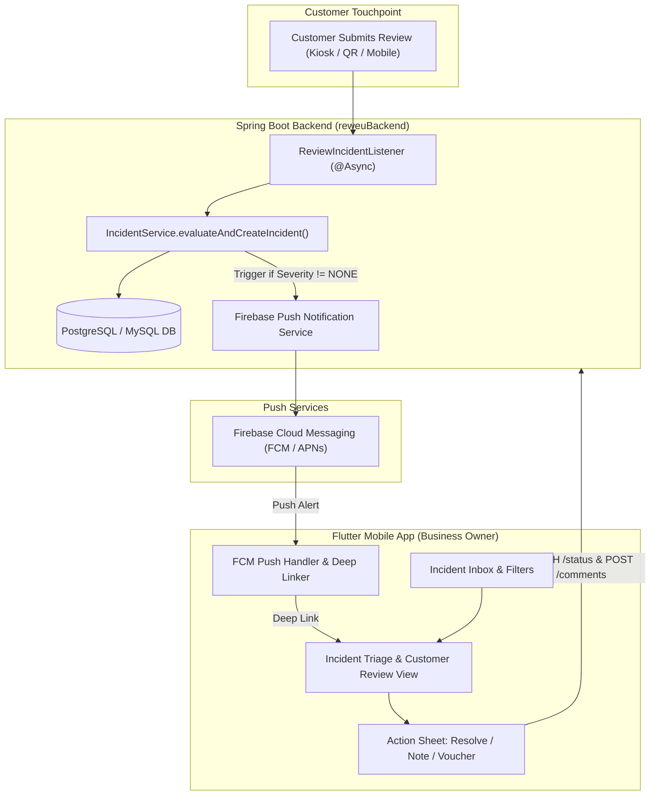
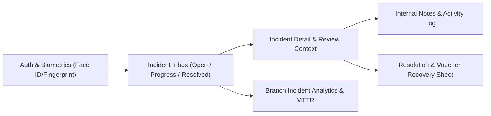
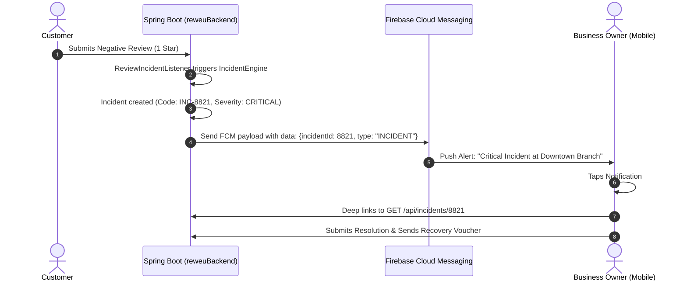

# Implementation & Architecture Plan: Reweu Incident Management Mobile App

## 1. Executive Summary & Objectives

### The Problem
Business owners and branch managers are rarely sitting at desktop computers during operational hours. When critical customer incidents occur (e.g., 1-star reviews citing food hygiene, rude staff, or billing errors), immediate response within minutes is required to prevent customer churn and brand damage. The existing desktop-oriented Flutter Web Admin Panel lacks reliable mobile push notifications, biometrics, and touch-optimized triage workflows.

### The Objective
Deliver a dedicated, high-performance Flutter mobile application (**"Reweu Business Companion / Incident Manager"**) for iOS and Android that:
1. Delivers **instant push notifications** (FCM/APNs) with custom severity sounds and app badge counts.
2. Enables **one-tap triage**: opening an alert deep-links directly to customer review details, branch metadata, and sentiment tags.
3. Facilitates **rapid resolution**: internal team notes, status updates (Acknowledged, Resolved), and customer service recovery vouchers.
4. **Reuses 75%+ of existing frontend code** from `reweuadminpanel` (models, Dio interceptors, repositories, and themes) and interfaces with existing Spring Boot backend endpoints.

---

## 2. End-to-End System Architecture



---

## 3. Core Mobile Screens & User Experience



### Screen 1: Authentication & Biometrics
- **Persistent Session**: Secure token storage via `flutter_secure_storage`.
- **Biometric Unlock**: `local_auth` for instant Face ID / Fingerprint unlock so owners don't type passwords during emergency alerts.
- **Multi-Branch Selector**: Dropdown or switch drawer if the owner manages multiple locations.

### Screen 2: Incident Feed (Home Inbox)
- **Top Segmented Control**: 
  - `New (Open)`: Highlighting unresolved incidents with elapsed time (e.g., *14m ago*).
  - `In Progress`: Acknowledged or actively investigated.
  - `Resolved`: History and resolution archive.
- **Incident Card Elements**:
  - Severity indicator pill (Critical: Red, High: Orange, Medium: Yellow, Low: Blue).
  - Branch name, customer name, star rating (1–5).
  - Trigger tags: (e.g., `HYGIENE`, `COLD FOOD`, `BILLING`, `STAFF BEHAVIOR`).
  - SLA time elapsed badge.
- **Interactions**:
  - Pull-to-refresh.
  - Swipe-to-Acknowledge.
  - Search & severity/branch filters.

### Screen 3: Incident Detail & Triage View
- **Customer Context Card**:
  - Full review text with highlighted negative sentiment keywords.
  - Customer contact details (with tap-to-call or tap-to-WhatsApp actions).
  - Specific rated metrics (Food quality, Ambience, Speed of service, Value for money).
- **Incident Lifecycle Timeline**:
  - Audit trail showing when detected, who acknowledged, and who commented.
- **Internal Discussion Stream**:
  - WhatsApp-style internal team notes for branch managers and owners to coordinate.

### Screen 4: Action & Service Recovery Modal (Bottom Sheet)
- **Status Transition**: Move from `OPEN` $\rightarrow$ `ACKNOWLEDGED` $\rightarrow$ `RESOLVED`.
- **Resolution Summary**: Text area for root-cause note (e.g., *"Table 4 manager apologized, item replaced"*).
- **Service Recovery Voucher Integration**:
  - Toggle: `Send Customer Recovery Voucher`.
  - Amount input or predefined voucher selector (leveraging the backend's `sendVoucher` and `voucherAmount` parameters).

### Screen 5: Quick Mobile Analytics
- **Cards**:
  - Total Incidents Today vs. Last 7 Days.
  - Mean Time to Resolution (MTTR).
  - Repeat complaints by category.

---

## 4. API & Backend Contract Mapping

The mobile app will consume the existing Spring Boot APIs defined in `IncidentController.kt`:

| Operation | Method & Endpoint | Payload / Query Params | Mobile UI Component |
| :--- | :--- | :--- | :--- |
| **Fetch Incident Feed** | `GET /api/incidents/business/{businessId}` | `status`, `branchId`, `page`, `size` | Incident Feed / Infinite Scroll |
| **Fetch Incident Detail** | `GET /api/incidents/{id}` | Path variable `id` | Detail Screen & Activity Stream |
| **Add Internal Note** | `POST /api/incidents/{id}/comments` | `{"comment": "Manager contacted table"}` | Internal Notes chat bar |
| **Update Status & Voucher** | `PATCH /api/incidents/{id}/status` | `status`, `resolutionSummary`, `sendVoucher`, `voucherAmount` | Resolution Bottom Sheet |
| **Incident Analytics** | `GET /api/incidents/analytics/business/{businessId}` | `startDate`, `endDate` | Mobile Dashboard Summary |
| **Register FCM Token** | `POST /api/users/device-token` *(To be added/verified)* | `{"token": "fcm_xyz", "platform": "android"}` | App Initializer / Background Handler |

---

## 5. Code Reuse from Existing Admin Panel

Because `reweuadminpanel` is written in Flutter, the mobile project can directly reuse:

```
reweuadminpanel/lib/
 ├── models/
 │    └── incident.dart              --> 100% reusable (IncidentListResponse, IncidentDetailResponse, AssigneeInfo)
 ├── services/
 │    ├── api_service.dart           --> 95% reusable (Dio client, JWT header interceptor, BaseURL)
 │    └── storage_service.dart       --> 90% reusable (Auth token caching)
 ├── theme/
 │    └── app_theme.dart             --> 85% reusable (Brand color palette, typography, status badges)
 └── blocs/
      └── auth/                      --> 90% reusable (Login, Session management, Role verification)
```

---

## 6. Push Notification & Deep Linking Architecture



### Push Payload Schema
```json
{
  "to": "<OWNER_FCM_TOKEN>",
  "notification": {
    "title": "🚨 Critical Incident: Downtown Branch",
    "body": "Customer reported Food Safety issue (1★). Immediate attention required.",
    "sound": "critical_alert.aiff"
  },
  "data": {
    "click_action": "FLUTTER_NOTIFICATION_CLICK",
    "type": "INCIDENT_ALERT",
    "incidentId": "8821",
    "businessId": "12",
    "severity": "CRITICAL"
  }
}
```

---

## 7. Phased Implementation Roadmap

### Phase 1: Mobile Project Setup & Shared Core (Days 1–2)
- [ ] Scaffold dedicated Flutter mobile project or mobile build flavor (`reweu_business`).
- [ ] Import shared `models/incident.dart`, `api_service.dart`, and `app_theme.dart`.
- [ ] Implement biometric login (`local_auth` + `flutter_secure_storage`).

### Phase 2: Incident Feed & Detail Screens (Days 3–5)
- [ ] Implement `IncidentFeedScreen` with tabbed status filters (`OPEN`, `ACKNOWLEDGED`, `RESOLVED`).
- [ ] Implement severity badges, search filter, and pull-to-refresh.
- [ ] Build `IncidentDetailScreen` displaying customer review, sentiment metrics, and activity timeline.

### Phase 3: Actions, Comments & Service Recovery (Days 6–7)
- [ ] Build internal commenting interface.
- [ ] Build `ResolutionBottomSheet` with status switcher, resolution notes, and voucher checkbox.
- [ ] Wire status update API with `sendVoucher` and `voucherAmount`.

### Phase 4: Push Notifications & Deep Linking (Days 8–10)
- [ ] Configure `firebase_core` and `firebase_messaging`.
- [ ] Integrate device token registration in Spring Boot backend.
- [ ] Add background notification handling and deep-link routing directly to `IncidentDetailScreen`.

### Phase 5: Polish & Deployment (Days 11–12)
- [ ] Offline caching and network resilience.
- [ ] Test notification latency and background wake-up on Android and iOS.
- [ ] Configure release builds (APK/AAB for Android, IPA for iOS TestFlight).

---

## 8. Key Architectural Decisions for Discussion

1. **Monorepo / Shared Package vs. Standalone Mobile App**:
   - *Option A (Recommended)*: Multi-project structure where mobile app and admin panel share a `core` package (or mobile code resides in a separate repo/app with copied models).
   - *Option B*: Unified Flutter Adaptive Project (same repository with responsive layouts for Web, Desktop, and Mobile).
2. **Backend Notification Endpoint**:
   - Verify if `reweuBackend` currently has an active FCM registration table (`UserDeviceToken` or similar) or if this needs to be implemented.
